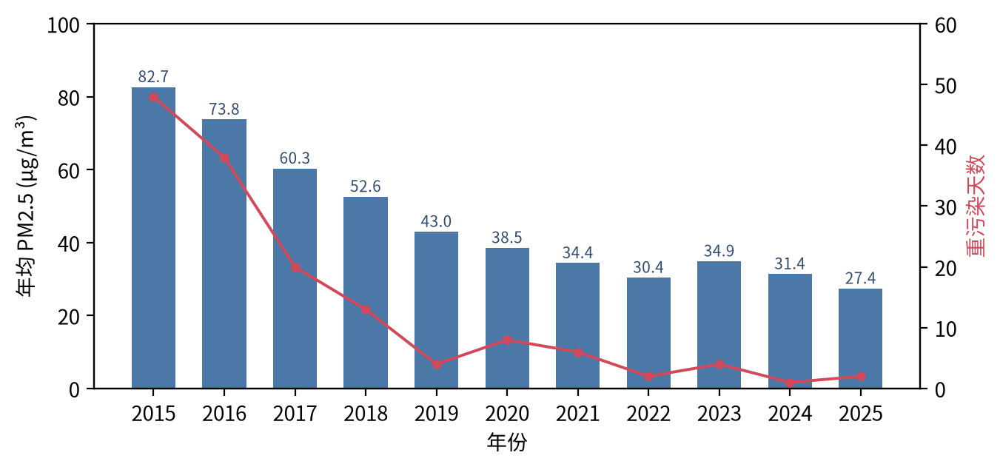
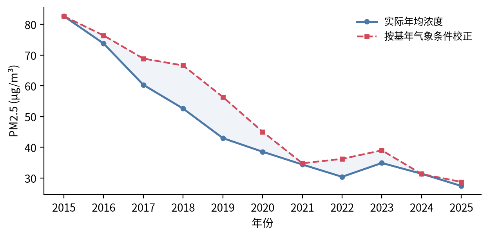

# 北京 PM2.5 污染数据清洗与趋势分析（2015—2025）

从 3 999 个原始日文件、约 **995 万**个监测单元格出发，构建 35 个国控站点的城市日度面板，并对十年降幅做气象校正归因。

> **项目定位**：面向真实公开数据的端到端清洗工程——多源异构数据合并、四级质控规则、与官方口径交叉验证，以及在此之上的统计建模。


---

## 项目背景

大气污染物浓度由**排放强度**与**气象条件**共同决定。北京 PM2.5 年均浓度从 2015 年的 82.7 μg/m³ 降至 2025 年的 27.4 μg/m³，但"浓度下降"并不等于"治理有效"——若观测期恰好多风多雨，浓度同样会下降。本项目先解决数据质量问题，再用回归校正气象影响，回答改善究竟来自"人努力"还是"天帮忙"。

## 数据规模与来源

| 数据 | 来源 | 规模 | 粒度 |
|---|---|---|---|
| 空气质量 | [中国空气质量在线监测分析平台](https://quotsoft.net/air/) | 3 999 个日文件 / 284 422 行 | 35 站点 × 24 小时 × 3 指标 |
| 气象 | [Open-Meteo Archive API](https://archive-api.open-meteo.com/)（ERA5 再分析） | 4 018 天 | 日度，北京城区格点 |
| 时间跨度 | — | 2015-01-01 — 2025-12-31 | 4 018 个自然日 |

原始数据为"站点—小时"宽表（每文件 38 列），需先纵向合并、再逐级聚合。

## 数据清洗流程

清洗按 **文件 → 单元格 → 小时 → 日** 四级递进，每一级都记录可审计的剔除量：

| 级别 | 规则 | 处理结果 |
|---|---|---|
| ① 文件完整性 | 逐日核对存在性与文件大小 | 4 018 应有 → 3 999 实得，缺失 19 天（0.47%），**不插值** |
| ② 单元格有效性 | 剔除空值、负值、超物理上限（PM2.5>1000 / PM10>2000 / AQI>500） | 剔除空值 866 466 个（8.70%）、超限 1 300 个（0.013%）、负值 0 |
| ③ 小时聚合 | 单整点有效站点数 ≥ 60%（21/35）才计算城市小时均值 | 287 928 个"小时×指标"组合中剔除 18 565 个（6.45%） |
| ④ 日聚合 | 单日有效小时数 ≥ 18（75%）才计算日均值 | 剔除 63 天，保留 3 936 天（覆盖率 **97.96%**） |
| ⑤ 气象合并 | 按日期左连接 ERA5 日度数据 | 3 999 天全部匹配 |
| ⑥ 派生变量 | 对数浓度、PM2.5/PM10 比值、采暖季标记、年份趋势项 | 13 个建模变量 |

**为什么这样设计**

- **不插值**：缺失日呈块状分布（如 2017-05-19 至 05-27）、属源站归档缺口，插值会人为压低方差、平滑极值；
- **60% 站点门槛**：避免少数站点故障读数代表全城，把"覆盖不足"与"污染过程"区分开；
- **18 小时门槛**：日均值至少覆盖 75% 的时段，兼顾样本量与代表性；
- **空值集中诊断**：空值主要来自 2015—2016 年 PM10 的部分站点，这也解释了 PM10 有效样本（3 127 天）少于 PM2.5（3 936 天）。

## 清洗质量验证

| 核验项 | 本文结果 | 官方口径 | 结论 |
|---|---|---|---|
| 2015 年 PM2.5 年均值 | 82.7 μg/m³ | 80.6 μg/m³ | 偏差 2.6% |
| 2015 年重污染天数（>150 μg/m³） | 48 天 | 46 天 | 量级一致 |
| 内部一致性 | PM2.5–PM10 相关 0.82；PM2.5–AQI 相关 0.92 | — | 符合同源同过程 |

## 关键结果



- **趋势**：年均浓度 82.7 → 27.4 μg/m³（**−66.8%**，几何年均 −10.5%）；重污染天数 48 → 2 天；达标率 59.0% → 95.3%；95 分位 237 → 72 μg/m³。
- **季节**：1 月均值是 8 月的 2.1 倍，采暖季比非采暖季高约 40%。
- **回归**（ln PM2.5 ~ 年份趋势 + 气象 + 月份固定效应，Newey-West HAC 滞后 14 期）：

| 变量 | 模型（1） | 模型（2） |
|---|---|---|
| 年份趋势 | −0.1078*** (0.0045) | −0.1117*** (0.0052) |
| 风速 | — | −0.0162*** (0.0024) |
| 气温 | — | 0.0698*** (0.0044) |
| 相对湿度 | — | 0.0273*** (0.0010) |
| 降水 | — | −0.0155*** (0.0033) |
| R² | 0.191 | 0.562 |
| N | 3 936 | 3 936 |

- **归因**：十年对数降幅中，**趋势项占 95.7%**、气象条件仅占 4.3%——改善主要不是"天帮忙"。



> 上图为按 2015 年气象条件校正的反事实序列：2016—2020 年校正值明显高于实际值（2019 年高出约 31%），说明当年气象偏有利、放大了表观改善。

## 项目结构

```
beijing-pm25-clean/
├── src/
│   ├── download.py          # 原始日文件 + ERA5 气象数据下载（断点续传、并发）
│   ├── clean.py             # 四级清洗主流程，输出面板与质控报告
│   └── analyze.py           # 描述统计、HAC 回归、气象校正、绘图
├── notebooks/
│   └── 01_pm25_data_cleaning_and_analysis.ipynb   # 完整分析流程（含输出）
├── data/
│   ├── raw_beijing_site_hour_2015_2025.csv.gz     # 合并后的原始宽表（35 站点×24 小时×3999 天）
│   ├── weather_beijing_daily_2015_2025.csv        # ERA5 日度气象
│   ├── station_name_mapping.csv                   # 站点槽位与两套站名映射
│   └── raw_sample/beijing_all_20240115.csv        # 单个原始日文件样例（格式参考）
├── output/                  # 清洗后日度面板、描述统计、回归结果、质控 JSON
├── figures/                 # 5 张成图（200 dpi）
├── docs/experiment-report.pdf
├── requirements.txt
└── README.md
```

## 运行方式

```bash
pip install -r requirements.txt

# 1) 清洗（读取 data/ 中的合并原始宽表）
python src/clean.py

# 2) 统计分析 + 生成图表
python src/analyze.py

# 3) 如需从源头重新下载原始数据（可选，耗时较长）
python src/download.py --start 2015-01-01 --end 2025-12-31
```

全部结果可复现：`output/cleaning_stats.json` 记录每一步剔除量，`output/analysis_summary.json` 记录回归与分解结果。

## 技术栈

`pandas`（宽表合并、时间序列重采样、分箱聚合）、`numpy`、`statsmodels`（HAC-robust OLS）、`matplotlib`（出版级图表）、`Jupyter`、`python-docx`（实验报告排版）。

## 说明与局限

- 本项目为观测数据的回归校正，仅控制可观测气象混杂，不作严格因果推断；
- 气象再分析资料与站点观测的空间尺度差异可能低估局地静稳条件的作用；
- 原始数据版权归原发布方所有，本项目仅用于学习与研究。

## License

MIT
